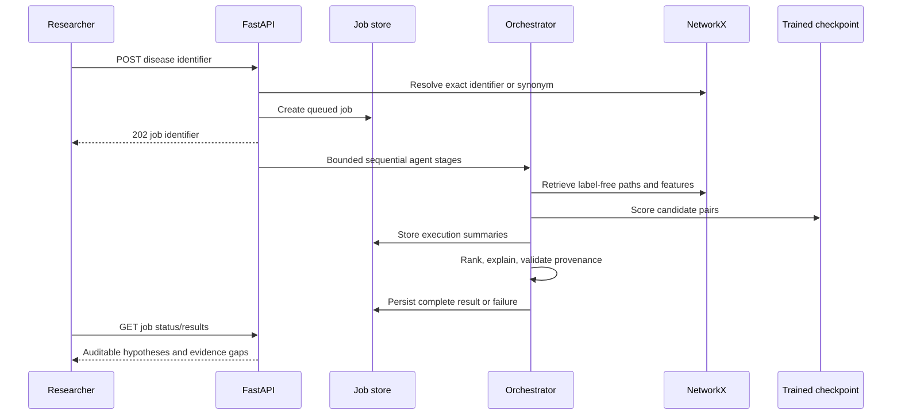

# Architecture and operational behavior

The source tree uses compact functional modules rather than the original prompt's hundreds of file names. `schemas.py` holds validated graph contracts, `graph.py` graph construction and queries, `ml.py` training/inference/evaluation, `storage.py` SQL models, `neo4j_store.py` the graph persistence adapter, `connectors.py` retrieval clients, `agents.py` orchestration, and `main.py` REST/job wiring. The frontend separates API access, Cytoscape lifecycle and the research UI.

All nine agents are deterministic computational modules. No remote LLM is invoked. They execute in a fixed acyclic sequence, with typed orchestration state and schema-validated input graph and prediction requests. Stage summaries and full final results persist in SQL. Each stage has a 120-second await timeout. Python thread cancellation cannot terminate an underlying computation; this is not a hard process deadline. Training and discovery share an asyncio lock in a single API worker. Use **one Uvicorn worker**: there is no distributed lock or durable task queue.

Jobs interrupted by process restart become failed at the next startup. There is no automatic recovery or retry for inference; connector transient HTTP failures receive bounded retries. Job history is durable but the worker itself is in-process. Use a real queue, migrations, authentication and resource controls before multi-user deployment.

NetworkX serves graph queries. Neo4j persistence is write-through startup synchronization, not the primary query engine. Both preserve graph edge provenance. There is currently no transactional graph version promotion, deletion synchronization or backup procedure. SQL generic JSON entity tables keep canonical IDs and relationships with foreign keys; dedicated pharmacology and publication schemas remain future work.

The frontend only displays backend data, actual measured metrics or explicit empty states. Graph paths show direction and provenance; an undirected traversal step is explicitly marked as reverse traversal where applicable. Paths are connectivity artifacts. Separately, bounded single-edge occlusion recomputes the trained model score after removing each path edge and its inverse. Neither method establishes biological causality.

The real-source path adds bounded Open Targets ETL and Europe PMC context retrieval. Ingestion stages a raw-content-addressed snapshot without replacing the graph. Activation verifies/reconstructs the snapshot, synchronizes configured stores, then swaps graph/model/orchestrator state under the model lock. The active pointer is replaced atomically and survives restart. SQL/Neo4j writes are not a distributed transaction. Clinical edges remain in the evidence graph but are excluded from predictive features, controls and new-candidate generation. Unreviewed publication nodes are excluded from R-GCN embeddings.
